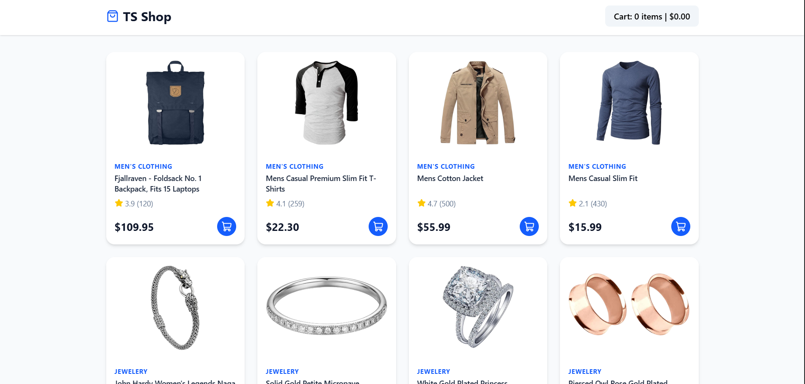

# 🛍️ TS Shop

A modern, fully responsive e-commerce store built with **React**, **TypeScript**, **Zustand**, and **Tailwind CSS**.


🔗 **Live Demo:**



Live : <https://react-typescript-ecommerce-ten.vercel.app>

## ✨ Features

- 🛒 **Global Cart State:** Add, remove, and update item quantities seamlessly.
- 💾 **Persistent Cart:** The cart is saved to `localStorage`, so items survive page refreshes.
- 🔒 **Type Safety:** Fully typed with TypeScript (interfaces for Products, CartItems, and Store State).
- 📱 **Responsive Design:** A beautiful CSS grid layout that adapts to mobile and desktop.
- ⚡ **Lightning Fast:** Built with Vite and Zustand for minimal re-renders.
- 🎨 **Modern UI:** Clean, modern interface with a slide-out cart sidebar using Lucide icons.

## 🛠️ Tech Stack

- **Framework:** React 19 + Vite
- **Language:** TypeScript
- **State Management:** Zustand (with persist middleware)
- **Styling:** Tailwind CSS
- **Icons:** Lucide-React

## 🚀 Getting Started

1. Clone the repo: ```bash
  git clone <https://github.com/YOUR_USERNAME/ts-shop.git>

2. Install dependencies:
  npm install
3. Start the development server:
  npm run dev

## 🧠 Architecture Highlights

Zustand for Global State: Chose Zustand over Context API to prevent unnecessary re-renders of the entire application when the cart updates.

TypeScript Interfaces: Defined strict types (Product, CartItem) to ensure the API data matches the UI expectations, preventing runtime crashes.

Custom Slide-out UI: Built a custom cart sidebar with dark overlays and smooth CSS transitions, avoiding heavy UI libraries.
